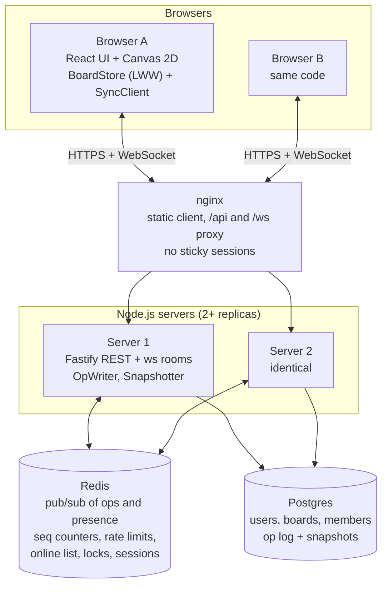

# Collaborative Whiteboard

A real-time multiplayer whiteboard, a small Excalidraw/Miro. Several people draw on the same board at once (shapes, freehand pen, sticky notes), see each other's cursors live, keep working through network drops, and never lose an acknowledged edit.

The point of the project is the sync engine and the backend. Conflict resolution, the op log, catch-up, multi-server fan-out and the canvas scene are all written from scratch: no Yjs, Automerge, Liveblocks, Socket.io, Konva or Fabric.js.

**Live demo:** **https://collab-whiteboard-nmn6.onrender.com**. Sign up, create a board, and open it in a second browser or use **Share** to invite someone. It runs on free tiers: the first visit after 15 idle minutes takes about a minute to wake up. See [Live demo limits](#live-demo-limits).

## Features

- Rectangles, ellipses, arrows, freehand pen (streamed while drawing, simplified with RDP, smoothed with Bézier curves), sticky notes, eraser.
- Select, move, resize, box-select, recolor, bring to front / send to back, delete.
- Per-user undo/redo that never undoes someone else's edit.
- Live cursors, selections, online list, and a "someone is typing" lock on sticky notes.
- Works offline: edits are applied at once and queued (in IndexedDB, so a reload or closed tab loses nothing), then sent when the connection returns.
- Accounts, boards, roles (owner / editor / viewer, with a read-only UI for viewers), invites by email and share links.
- Several server replicas behind a load balancer, kept in sync through Redis.

## Architecture



- **Client:** every edit is an op applied locally at once (optimistic) and kept pending until the server acks it.
- **Server:**
  - **Pipeline:** each op is validated and authorized, given a sequence number from Redis, and applied to the in-memory room.
  - **Delivery:** the op goes to local sockets and is published to the other servers right away.
  - **Acks:** the sender is acked only after the op is committed to Postgres.
- **Ordering:** servers deliver ops in whatever order they get them, which LWW makes safe. Each server tracks a watermark of what it has delivered without gaps, and clients use that watermark to catch up after a disconnect.

The live demo runs a single-service version of this: one server that also serves the built client, no nginx (see [Live demo limits](#live-demo-limits)).

Full design: [docs/system-design.md](docs/system-design.md) (protocol, data model, failure handling, security) and [docs/algorithms.md](docs/algorithms.md).

## Algorithms (all hand-written)

| Algorithm | Where | What it's for |
| --- | --- | --- |
| Lamport clocks | `packages/shared` | Order concurrent edits without trusting wall clocks |
| Last-Writer-Wins registers per property | `packages/shared` | Conflict-free merge: commutative, associative, idempotent |
| Tombstones + time-based GC | shared / server | Deletes that survive reordering; old tombstones collected at snapshot time |
| Fractional indexing (`keyBetween`) | `packages/shared` | Z-order where moving one shape changes only that shape |
| Op log + snapshots + `lastSeq` catch-up | server | Durable history, fast loads, reconnect without a full reload |
| Watermark + gap filling across servers | server | Correct catch-up when Redis delivers ops out of order or drops one |
| Ramer–Douglas–Peucker + Bézier smoothing | client | Small, smooth freehand strokes |
| Quadtree | client | Viewport culling and hit testing at 20,000 shapes |
| Camera maths (zoom to cursor, HiDPI) | client | World ↔ screen coordinates |
| Inverse-op undo/redo with LWW skip rule | client | Undo only your own edits, even after others changed the shape |
| Token buckets (Redis + local) | server | Per-user op limits across servers, per-socket message limits |
| Server-side cursor batching | server | One presence message per socket every 50 ms instead of O(n²) |

## Benchmarks

Measured on the production stack (two replicas behind nginx, Postgres, Redis); full method and raw numbers in [docs/benchmarks.md](docs/benchmarks.md).

| | Result |
| --- | --- |
| Editors on one board with p95 < 150 ms (GitHub runner, 2 vCPU) | **50** (p50 21 ms, p95 66 ms, p99 97 ms; 248 ops/s, 12,100 deliveries/s) |
| Latency at 10 editors (same server / across servers through Redis) | p50 2.0 / 2.8 ms, p95 4.7 / 6.1 ms |
| Cursor batching (50 editors, p95) | 31.8 s → 66 ms |
| Kill a server replica under load | clients reconnect to the other in 2.7 s, no acked op lost |
| Restart or wipe Redis under load | no sequence collisions |
| Freeze Postgres for 40 s | "Saving paused" shown at 32 s, everything saved after recovery |
| Board with 2,100 ops / 1,000 shapes | loads in about 55–85 ms on the server |
| Randomized convergence test | 0 divergences in 500 seeds × 1,000 ops |

These are a lower bound. The load generator and the whole stack shared one 2-vCPU machine.

## Running it locally

Needs Node 22, pnpm 10.18.3 (`corepack enable`), and Docker.

```bash
docker compose up -d          # Postgres (host port 55432) and Redis (56379) for development
pnpm install
pnpm dev                      # server on :3001 (tsx watch) + client on :5173 (Vite)
```

Open http://localhost:5173, sign up, create a board, and open it in a second window (or a second browser) to collaborate.

The full production stack (two server replicas, nginx with a strict CSP, Postgres, Redis):

```bash
cp .env.prod.example .env.prod   # then put real secrets in it (never committed)
docker compose -f docker-compose.prod.yml --env-file .env.prod up -d --build --wait   # http://localhost:8080
pnpm test:smoke
```

## Testing

```bash
pnpm typecheck && pnpm lint
pnpm test                 # unit tests + convergence test (50 seeds)
pnpm test:convergence     # all 500 seeds
pnpm test:integration     # real servers against Docker Postgres and Redis
pnpm test:e2e             # Playwright against built output: two servers, several browser tabs
pnpm bench:load           # load ramp against the production stack
pnpm bench:chaos          # chaos tests against the production stack
```

The suite has 195 unit tests, the 500-seed convergence test, 68 integration tests and 36 Playwright E2E tests. GitHub Actions runs typecheck, lint, unit, convergence, integration and E2E on every push. A second job builds the production images, starts the stack and runs the smoke test. The load ramp runs on demand (`load-test.yml`).

**Convergence test.** The core claim is that every client ends with the same board, whatever order ops arrive in. The test builds 5 simulated clients and has them make 1,000 random ops (create, move, recolor, delete, reorder, stroke appends and pen-up). It then delivers the ops in random order, with random delays and duplicates, and checks that all five boards are identical. It runs with 500 seeds; any failing seed can be replayed exactly with `CONVERGENCE_SEED=n`. It also checks that the tricky paths were actually exercised: ops arriving before their create, updates landing on tombstones, appends after pen-up, and duplicates.

**Integration and E2E.** Real servers, real Postgres and Redis, real browsers. Things these tests cover:
- Two tabs dragging the same shape at once end identical.
- A server killed between commit and ack loses nothing and duplicates nothing.
- A pub/sub message dropped between servers delays only the watermark, never other edits.
- Logging out in one tab closes the session's sockets on every server.
- An offline tab catches up from its `lastSeq` without reloading.

E2E tests read state only through a read-only debug handle and act only through real mouse and keyboard input.

**Chaos tests.** Under load from 10 clients running the real sync code, the test:
- kills a server replica;
- restarts Redis, then wipes it, losing the sequence counters;
- freezes Postgres for 40 s.

Each client also creates a marker shape every second. Creates are never overwritten, so "every acked marker is still on the board at the end" proves no acknowledged edit was lost, even though snapshots prune the op log. The first runs found two real bugs:
- nginx waited 60 s on a dead replica before failing over (now 2 s);
- a frozen Postgres never triggered "Saving paused", because each attempt hung for about 60 s before counting as a failure (the outage clock now starts at the first attempt, with a watchdog).

Later, a timing test for that watchdog failed on a slow CI runner. It had found a real edge case: a timer can fire a fraction of a millisecond early, so the watchdog's own "is it time yet?" check said no, and the pause slipped to the next failure, about a minute later. The watchdog now pauses outright when it fires.

**Tests that lied, and how they were caught.**
- **Playwright's offline mode passed offline tests the queue never handled.** The offline-queue tests (go offline, draw, reload while offline, come back) passed at first, without the queue doing anything. Playwright's offline mode doesn't block WebSockets, and during `page.reload()` it briefly fires `online` in the old page. That page then reconnected and sent its edits just before unloading. The tests now simulate a real outage (offline mode plus refused WebSocket connections) and assert how many ops the reopened tab restored from IndexedDB. A version of the feature that never restored anything now fails.
- **The first load test on GitHub dropped bots without noticing.** It counted closed sockets only while measuring, so bots that died between steps went unnoticed and the 50- and 100-editor numbers looked better than they were. The script now stops the ramp as soon as the stack closes any socket, and those numbers were thrown out.
- **A chaos run reported every board as diverged when they weren't.** The boards differed only in the key order of JSON loaded back from Postgres JSONB. The comparison now sorts keys.

## Live demo limits

The public demo runs on free tiers (Render + Neon; setup in [docs/deploy.md](docs/deploy.md)), so it is much smaller than the benchmarked stack:

- **One server replica on 0.1 CPU and 512 MB.** It handles a few people per board, not 50. Sign-ups take a few seconds (bcrypt at cost 12).
- **It sleeps after 15 minutes without traffic.** The first visit after that waits about a minute. Saved boards are not affected.
- **Redis (Render Key Value) is in memory only.** If it restarts, logged-out sessions are forgotten until they expire (up to 7 days). A session cookie someone copied before you logged out would work again until then. The cookie is httpOnly and is deleted from your browser at logout, so this needs a stolen cookie. The full stack's Redis persists to disk and doesn't have this gap. Rate-limit counters also reset. Sequence counters are lost safely (the seq floor, chaos-tested).

## Repository layout

```
packages/shared   types, Lamport clock, LWW board, fractional index, geometry, Zod protocol (runs in plain Node)
packages/client   React UI chrome + raw Canvas 2D renderer, tools, BoardStore, SyncClient, offline queue
packages/server   Fastify REST + ws rooms, op pipeline, OpWriter, Snapshotter, Redis bus, rate limits
tests/            integration (Vitest), e2e (Playwright), smoke, convergence
scripts/bench/    load and chaos tests
deploy/, render.yaml   the single-service image and Render blueprint for the live demo
docs/             system design, algorithms, benchmarks, deploy (Render + Neon setup)
```
